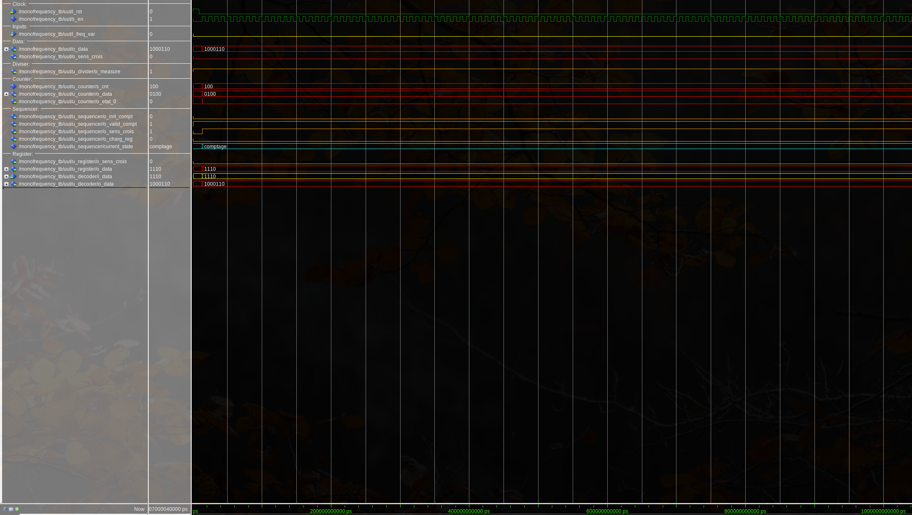
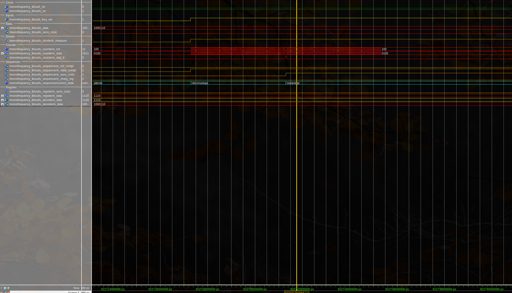
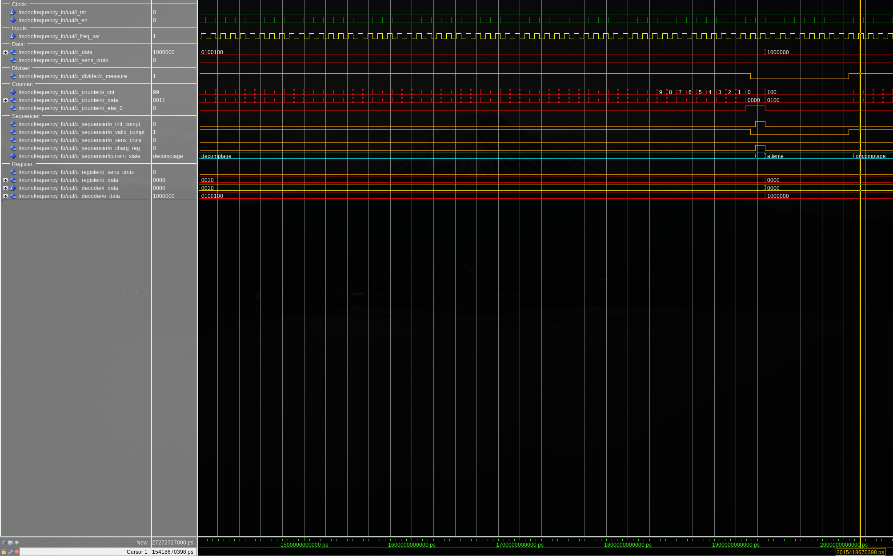

# Notes

## La mesure ne démarre pas

Fonctionne pas -> reste en mode `rst` ?

Bizarre à cause de la LED qui reflète l'état du `rst`.

Peut-être à cause de la clock (pas de front montant détecté donc `if rst => 0` et `elsif rising_edge => 0` donc il ne se passe rien)

> Panne trouvée :
> j'ai touché à la piste sacrée, du coup ma clock divisée était extrêmement lente par
> rapport à la clock
> (cf skew problem)

## La carte passe en mode `reset` sans appui physique

On peut voir le 'r' visible des fois sur le display

## Warnings

> [!WARNING]
> CLK Net : may have excessive skew because 0 CLK pins and 1 NON_CLK pins
> failed to route using a CLK template

Ce warning était le résultat que j'avais touché à la clock (c'est sacré). Résolue en synchronisant les composant sur `i_clk` puis en utilisant un signal enable `s_en`.

## `o_measure` infini

S'il n'y a pas de signal de mesure en entrée, `o_mesure` reste ouvert (car période infinie) :

> [!WARNING]
> Peut-être on devrait ajouter un watchdog, sinon on est toujours obligés d'appuyer sur le reset

## Pas de compteur à l'implémentation du s_en

Malgré les deux if pour éviter que `s_cnt` ne sorte de ses limites, warnings `vector truncated` ==> à cause de sa décroissance sur la clock et non plus sur les créneaux générés par s_en.
J'ai résolu le problème pour le compteur avec une bascule D mais je me rends compte qu'il est aussi valable pour les autres :

==Il faut ajouter des bascules D partout !?==

> En fait la bonne manière de faire est de ne laisser le `enable` que sur une seule clock haute. Plus besoin d'ajouter des bascules à gogo :

