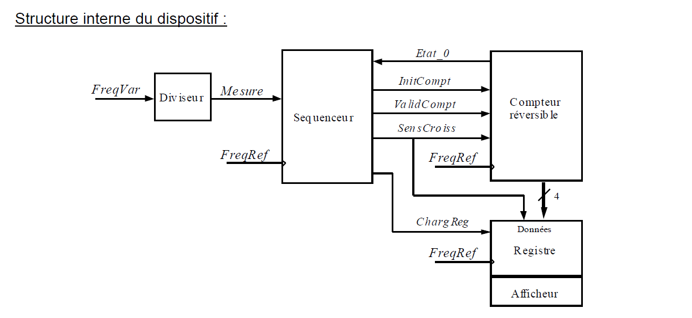
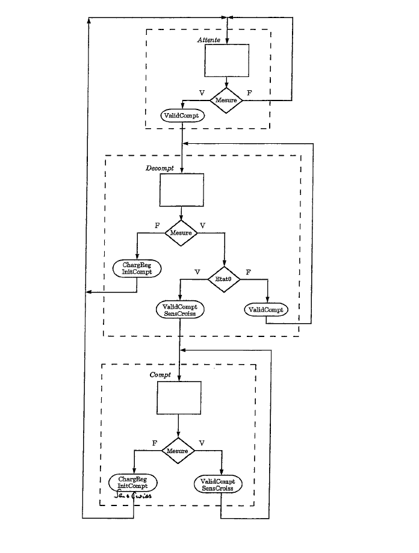

# 🎸 Accordeur Numérique pour Guitare — Projet FPGA

[]()
[]()
[]()

> Système matériel synchrone permettant de mesurer et d'afficher l'écart relatif entre la fréquence d'une corde de guitare jouée par l'utilisateur (`FreqVar`) et une fréquence de référence stockée en mémoire (`FreqRef`).

**Réalisé par :** Youssef, Jula, Lucas

---

## 📑 Table des matières

- [1. Présentation générale du projet](#1-présentation-générale-du-projet)
  - [Objectif et contexte](#objectif-et-contexte)
  - [Architecture globale du dispositif](#architecture-globale-du-dispositif)
- [2. Compte-rendu technique — Étude et conception du séquenceur](#2-compte-rendu-technique--étude-et-conception-du-séquenceur)
  - [2.1 Graphe d'état du séquenceur](#21-établissement-du-graphe-détat-du-séquenceur)
  - [2.2 Synthèse et schéma de réalisation](#22-synthèse-et-schéma-de-réalisation-du-séquenceur)
  - [2.3 Validation et simulation (ModelSim)](#23-validation-et-simulation-modelsim)
- [3. Conclusion](#3-conclusion)

---

## 1. Présentation générale du projet

### Objectif et contexte

L'objectif de ce projet est de concevoir un système matériel synchrone capable de mesurer et d'afficher l'écart relatif entre la fréquence d'une corde de guitare jouée par l'utilisateur (`FreqVar`) et une fréquence de référence stockée en mémoire (`FreqRef`).

### Architecture globale du dispositif

Le système repose sur une architecture synchrone cadencée par l'horloge de référence `FreqRef`. La structure interne du dispositif s'articule autour de **quatre grands blocs matériels** interconnectés :

<p align="center">
  
</p>

| Bloc | Rôle |
|---|---|
| 🔹 **Diviseur** | Génère une fenêtre temporelle active (`Mesure`) d'une durée exacte de 100 périodes de `FreqVar`. |
| 🔹 **Séquenceur** | Machine d'états finis (FSM) qui pilote l'enchaînement des opérations en fonction de l'état de la mesure et du compteur. |
| 🔹 **Compteur réversible** | Initialisé à la valeur décimale 100, il décompte puis recompte selon le chronomètre de mesure. |
| 🔹 **Registre et afficheur** | Mémorise le score final et le sens d'évolution pour restituer l'écart sur un afficheur signé. |

---

## 2. Compte-rendu technique — Étude et conception du séquenceur

Cette section détaille la méthodologie suivie pour la conception, la modélisation et la validation du séquenceur, en respectant rigoureusement l'ordre des questions du cahier des charges.

### 2.1 Établissement du graphe d'état du séquenceur

Le comportement du séquenceur est modélisé par une **machine d'états finis synchrone** comportant quatre états principaux :

| État | Description |
|---|---|
| **ATTENTE** | Au repos, initialise le compteur et attend l'activation de la fenêtre `Mesure`. |
| **DECOMPTAGE** | Dès que `Mesure` passe à l'état haut, le compteur décrémente à chaque front d'horloge. Si l'état zéro est atteint, la machine bascule en comptage. |
| **COMPTAGE** | Le compteur repart à la hausse pour mesurer l'écart positif restant. |
| **SAUVEGARDE** | À la fin de la fenêtre de mesure, le résultat est figé dans le registre avant de retourner à l'état `ATTENTE`. |

<p align="center">
  
</p>

### 2.2 Synthèse et schéma de réalisation du séquenceur

L'implémentation matérielle en VHDL sépare strictement :
- la **logique séquentielle**, synchronisée sur le front montant de l'horloge `i_freq_ref` ;
- la **logique combinatoire**, via un bloc `case` avec des valeurs par défaut pour éviter les latches parasites.

<details>
<summary>📄 Voir le code VHDL du séquenceur (<code>sequencer.vhd</code>)</summary>

```vhdl
library ieee;
use ieee.std_logic_1164.all;
use ieee.numeric_std.all;

entity sequencer is
    port (
        i_freq_ref    : in  std_logic;
        i_rst_n       : in  std_logic;
        i_mesure      : in  std_logic;
        i_etat_0      : in  std_logic;
        o_init_compt  : out std_logic;
        o_valid_compt : out std_logic;
        o_sens_croiss : out std_logic;
        o_charg_reg   : out std_logic
    );
end entity sequencer;

architecture rtl of sequencer is
    type state_type is (ATTENTE, DECOMPTAGE, COMPTAGE, SAUVEGARDE);
    signal current_state, next_state : state_type;
begin

    -- Processus séquentiel : mise à jour de l'état sur front d'horloge
    process(i_freq_ref, i_rst_n)
    begin
        if i_rst_n = '0' then
            current_state <= ATTENTE;
        elsif rising_edge(i_freq_ref) then
            current_state <= next_state;
        end if;
    end process;

    -- Processus combinatoire : calcul de l'état futur et des sorties
    process(current_state, i_mesure, i_etat_0)
    begin
        o_init_compt  <= '0';
        o_valid_compt <= '0';
        o_sens_croiss <= '0';
        o_charg_reg   <= '0';
        next_state    <= current_state;

        case current_state is
            when ATTENTE =>
                o_init_compt <= '1';
                if i_mesure = '1' then
                    next_state <= DECOMPTAGE;
                end if;

            when DECOMPTAGE =>
                o_valid_compt <= '1';
                o_sens_croiss <= '0';
                if i_mesure = '0' then
                    next_state <= SAUVEGARDE;
                elsif i_etat_0 = '1' then
                    next_state <= COMPTAGE;
                end if;

            when COMPTAGE =>
                o_valid_compt <= '1';
                o_sens_croiss <= '1';
                if i_mesure = '0' then
                    next_state <= SAUVEGARDE;
                end if;

            when SAUVEGARDE =>
                o_charg_reg <= '1';
                next_state  <= ATTENTE;

            when others =>
                next_state <= ATTENTE;
        end case;
    end process;

end architecture rtl;
```

</details>

### 2.3 Validation et simulation (ModelSim)

Le comportement dynamique du circuit a été validé par **simulation comportementale sous ModelSim**.

<p align="center">
  
</p>

**Analyse du chronogramme :**

- 🟦 Le signal de reset asynchrone `i_rst_n` (en haut, cyan) initialise proprement le système dans l'état `ATTENTE`.
- 🟧 Dès l'activation de `i_mesure` (orange), la machine passe de `ATTENTE` à `DECOMPTAGE`.
- ⚡ L'impulsion sur `i_etat_0` déclenche la transition vers `COMPTAGE` (inversion du sens).
- 🔁 Enfin, le retour à zéro de `i_mesure` déclenche l'état `SAUVEGARDE` (activation de `o_charg_reg`), bouclant parfaitement le cycle avant de retourner au repos.

---

## 3. Conclusion

L'implémentation en VHDL respecte scrupuleusement les règles de conception synchrone enseignées :

- ✅ séparation stricte de la logique séquentielle et combinatoire ;
- ✅ absence de latches parasites grâce aux valeurs par défaut.

Les simulations prouvent la **conformité fonctionnelle** du séquenceur et de l'ensemble de la chaîne de mesure de l'accordeur, ouvrant la voie au **placement-routage sur la cible FPGA**.

---

<p align="center">
  <sub>Projet réalisé dans le cadre d'un cours de conception numérique — © Youssef, Jula, Lucas</sub>
</p>