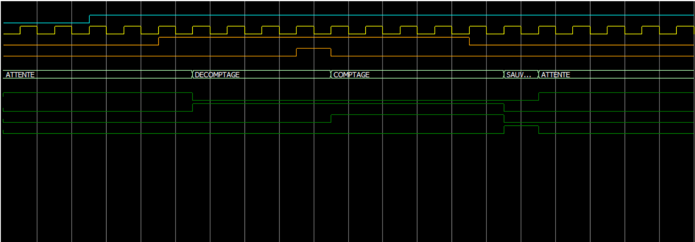

# 🎸 Projet Accordeur Numérique - Séquenceur (FSM)

Ce dépôt contient la conception et la simulation VHDL du **séquenceur**, qui fait office de chef d'orchestre dans le projet d'accordeur numérique pour guitare.

---

## 📋 Fonctionnement du Séquenceur

Le séquenceur est une machine d'états synchrone (sensible aux fronts montants de l'horloge de référence `i_freq_ref`) qui gère les différentes phases de la mesure comparative entre la fréquence variable de la corde (`FreqVar`) et la référence (`FreqRef`).

### Description des 4 états :
1. **`ATTENTE`** : Le système est au repos (ou vient de subir un reset `i_rst_n`). Le compteur est initialisé (`o_init_compt = '1'`). Il attend que la fenêtre de mesure s'ouvre (`i_mesure = '1'`).
2. **`DECOMPTAGE`** : Dès que la mesure est active, le compteur décrémente (`o_valid_compt = '1'`, `o_sens_croiss = '0'`). Si le compteur atteint zéro avant la fin de la mesure (`i_etat_0 = '1'`), le système bascule vers l'état de comptage croissant.
3. **`COMPTAGE`** : Le compteur repart à la hausse (`o_sens_croiss = '1'`) pour mesurer l'écart positif restant jusqu'à la fin de la fenêtre de mesure.
4. **`SAUVEGARDE`** : À la fin de la fenêtre (`i_mesure = '0'`), le séquenceur déclenche l'enregistrement du résultat dans le registre (`o_charg_reg = '1'`) avant de retourner sagement dans l'état `ATTENTE`.

---

## 📈 Simulation et Validation (ModelSim)

Le comportement dynamique du séquenceur a été simulé sous ModelSim à l'aide d'un banc de test (*testbench*). Le chronogramme ci-dessous illustre l'enchaînement correct des états et des signaux de commande :

### Commentaire du chronogramme :
* **Phase initiale (`ATTENTE`) :** Le signal de reset `i_rst_n` (en bleu clair) passe à l'état haut, libérant le circuit. Le signal d'horloge `i_freq_ref` (en jaune) cadence le système. Le signal `o_init_compt` est à '1'.
* **Phase active (`DECOMPTAGE` ➔ `COMPTAGE`) :** Dès l'ouverture de la fenêtre `i_mesure`, le séquenceur bascule en `DECOMPTAGE`. Lorsque le compteur atteint zéro (`i_etat_0` lève une impulsion), le sens s'inverse (`o_sens_croiss` passe à l'état haut).
* **Phase finale (`SAUVEGARDE`) :** Lorsque `i_mesure` retombe à '0', la machine passe par l'état de sauvegarde (`o_charg_reg` s'active brièvement) pour figer la valeur mesurée, puis retourne automatiquement dans l'état `ATTENTE`.

---

## 🎯 Conclusion

La simulation comportementale sous ModelSim confirme que la machine d'états répond parfaitement au cahier des charges fonctionnel. Les transitions entre les états `ATTENTE`, `DECOMPTAGE`, `COMPTAGE` et `SAUVEGARDE` s'effectuent de manière synchrone et sans aléas logiques, garantissant une exploitation fiable des données pour l'affichage de l'accordeur.